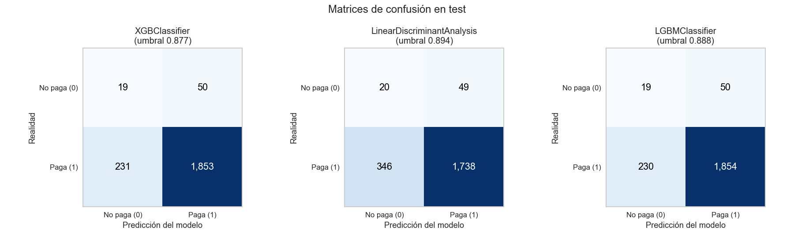
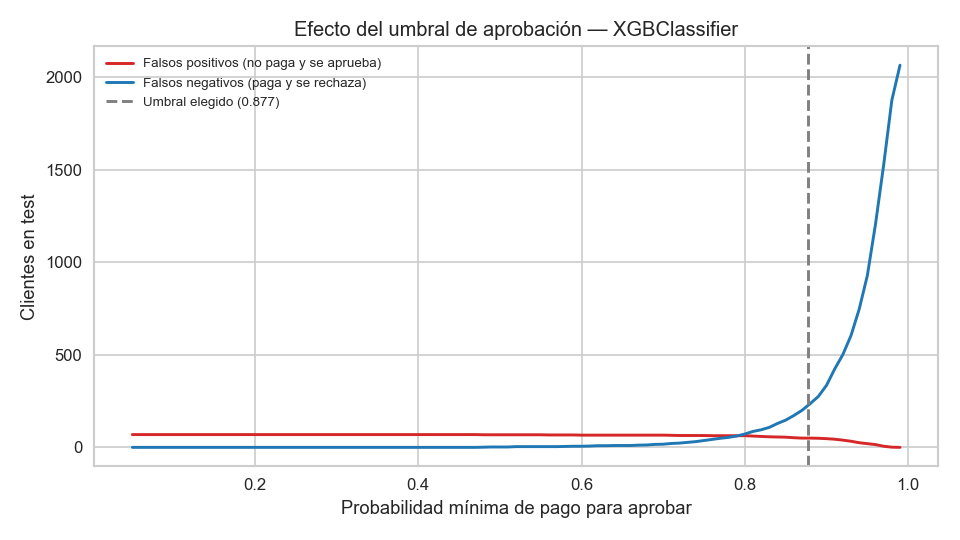

# Modelo de riesgo crediticio

## ¿Qué busca este proyecto?

Anticipar si un **nuevo cliente pagará su crédito a tiempo**, para decidir si es elegible antes de aprobarlo. El modelo aprende de 10 763 créditos otorgados entre noviembre de 2024 y abril de 2026, de los que ya se sabe si se pagaron a tiempo (`Pago_atiempo = 1`) o no (`0`).

## Lo que nos dijeron los datos

- **La gran mayoría paga:** 95 de cada 100 clientes pagan a tiempo. Por eso el "acierto" general engaña: un sistema que aprobara a todo el mundo acertaría el 95 % de las veces y no detectaría a ningún cliente que no paga.
- **Había datos erróneos escondidos**, como edades de 122 años, salarios de miles de millones o textos donde debía haber números. Se marcaron como "dato desconocido" en lugar de usarlos tal cual.
- **Que falte un dato también es una señal:** los clientes sin historial de ingresos en la central de riesgo (27 %) pagan un poco peor.
- **Señales de mayor riesgo:** tener mora vigente, muchas consultas recientes en la central, menor puntaje en la central, ingresos decrecientes, ser más joven y que el desembolso se haga en fin de semana. Todas tienen efectos **pequeños**.
- **`puntaje` (puntaje interno) se excluye del modelo:** separa perfectamente a quienes pagan de quienes no (*puntaje ≥ 63 paga, menos no paga*, sin ninguna excepción en los 10 763 créditos). Una variable así casi seguro se calcula con el propio resultado de pago y **no estará disponible al evaluar a un cliente nuevo** (fuga de información). Con ella, cualquier modelo da un resultado perfecto pero inútil. Se revisaron todas las demás variables y ninguna tiene una relación parecida: la más fuerte, el puntaje de la central de riesgo, ordena a los clientes solo de forma modesta (AUC 0.62 por sí sola).

## Cómo se construyó el modelo

1. **Limpieza y nuevas variables** ([ft_engineering.py](mlops_pipeline/src/ft_engineering.py)): se corrigen los datos erróneos, se crean indicadores útiles para el negocio, como el peso de la cuota sobre el salario o si el cliente tiene mora, y se llevan los montos a una escala comparable.
2. **Prueba realista:** el modelo aprende con los créditos más antiguos (80 %) y se evalúa con los **más recientes** (20 %, 2 153 créditos), como si fueran clientes nuevos que nunca vio.
3. **Comparación de 14 modelos** con PyCaret, incluidas versiones de XGBoost y LightGBM con árboles poco profundos, que memorizan menos ([model_training_evaluation.py](mlops_pipeline/src/model_training_evaluation.py)). La validación también respeta el orden temporal. A los 3 mejores se les intenta afinar la configuración, y el cambio solo se acepta si mejora el AUC de validación en al menos 0.01.
4. **Dos medidas, cada una para una decisión:** el **AUC** elige el modelo, porque indica qué tan bien ordena a los clientes del más confiable al más riesgoso (0.5 equivale a lanzar una moneda y 1.0 es perfecto). El **F1 de "no paga"** elige el punto de corte, usando solo los datos de entrenamiento. El F1 de "paga" no sirve aquí: aprobar a todos ya da 0.98.

## ¿Qué error es peor?

| Error | Qué pasa | Costo para el negocio |
|---|---|---|
| **Falso positivo** | El modelo dice "paga", se aprueba… y no paga | **Alto:** se pierde el capital prestado |
| **Falso negativo** | El modelo dice "no paga", se rechaza… y sí habría pagado | Menor: se pierde la ganancia de ese crédito |

**Conviene tolerar más falsos negativos que falsos positivos.** Es preferible rechazar a algunos buenos clientes que prestarle a quien no va a pagar. El punto de corte (la probabilidad mínima de pago exigida para aprobar) se puede subir para reducir los falsos positivos, a cambio de rechazar a más clientes buenos. Ese equilibrio lo debe fijar el negocio según cuánto cuesta cada error.

## Resultados

Los 3 mejores modelos, evaluados con los 2 153 créditos más recientes (sin `puntaje`):

| Modelo | AUC (clientes nuevos) | De 69 clientes que no pagaron, ¿cuántos detecta? | Clientes buenos rechazados | F1 "no paga" |
|---|---|---|---|---|
| **XGBoost** (elegido) | 0.67 | 19 (28 %) | 231 de 2 084 (11 %) | 0.12 |
| LightGBM | 0.67 | 19 (28 %) | 230 de 2 084 (11 %) | 0.12 |
| Linear Discriminant Analysis | 0.64 | 20 (29 %) | 346 de 2 084 (17 %) | 0.09 |

**El modelo todavía es débil (AUC 0.67).** Para detectar a 19 de los 69 malos pagadores rechaza a 231 clientes buenos: unos 12 buenos por cada malo detectado. Afinar la configuración no alcanzó la mejora mínima en ningún modelo, así que se conservaron las versiones sin afinar.

**Hay que leer estas cifras con cautela.** Con solo 69 malos pagadores, el AUC real podría estar entre 0.61 y 0.73 (intervalo de confianza del 95 %), así que las diferencias pequeñas entre modelos no son concluyentes. Además, parte de las decisiones de diseño se tomaron después de ver este conjunto de prueba, por lo que el 0.67 puede ser algo optimista.



La siguiente gráfica muestra el equilibrio entre los dos errores según el punto de corte. Para bajar los falsos positivos (rojo) hay que exigir una probabilidad muy alta, y entonces los clientes buenos rechazados (azul) se disparan.



Más gráficos (comparación de métricas, curvas ROC, variables más importantes) y las tablas completas están en [mlops_pipeline/reportes/](mlops_pipeline/reportes/).

## Conclusión

- **Todavía no hay un modelo listo para decidir solo** si se aprueba un crédito. La información disponible solo permite distinguir de forma modesta a quienes pagarán.
- Por ahora puede servir como **apoyo**: una alerta para que un analista revise con más cuidado las solicitudes de mayor riesgo.

## Próximos pasos

1. **Confirmar con el negocio qué es `puntaje`** y en qué momento se calcula. Si de verdad existe antes de aprobar el crédito, se podría volver a incluir y el problema estaría prácticamente resuelto.
2. **Definir el costo de cada error** (pérdida promedio por mal pagador frente a ganancia por buen cliente) para fijar el punto de corte óptimo.
3. **Sumar información** sobre el comportamiento de pago previo del cliente y esperar a que maduren los créditos recientes: algunos todavía no han tenido tiempo de caer en mora.

---

## Estructura y ejecución

```
mlops_pipeline/
├── src/
│   ├── Cargar_datos.ipynb              # lectura de Base_de_datos.xlsx
│   ├── comprension_eda.ipynb           # análisis exploratorio
│   ├── ft_engineering.py               # limpieza, variables, train/test, ColumnTransformer
│   └── model_training_evaluation.py    # comparación, ajuste y evaluación con PyCaret
├── reportes/                           # gráficos y tablas de resultados
└── models/                             # mejor modelo: preprocesador + modelo + punto de corte (.joblib)
```

```powershell
python -m venv .venv
.venv\Scripts\activate
pip install -r requirements.txt
cd mlops_pipeline\src
python model_training_evaluation.py
```

Requiere Python 3.9–3.11 (límite de PyCaret 3.3). `Base_de_datos.xlsx` debe estar en la raíz del proyecto o en una carpeta superior.
